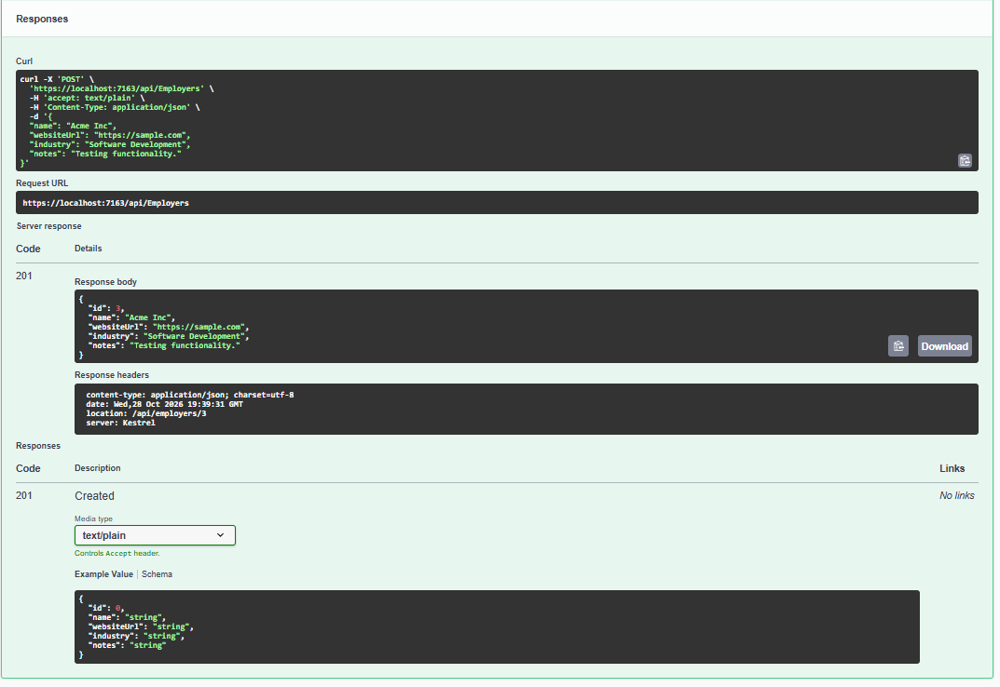

# JobPilot AI

**A job application tracking platform built with ASP.NET Core, Entity Framework Core, and PostgreSQL.**

JobPilot AI is an ongoing personal software engineering project designed to organize employers, job opportunities, applications, status changes, and follow-up reminders.

The project demonstrates backend API development, relational database design, dependency injection, repository patterns, and RESTful application architecture.

## Technology Stack

- **Backend:** C#, ASP.NET Core, .NET 10
- **Database:** PostgreSQL
- **ORM:** Entity Framework Core with Npgsql
- **API Documentation:** Swagger / OpenAPI
- **Architecture:** Controller-based REST API, repository pattern, dependency injection
- **Development Tools:** Visual Studio Code, Git, GitHub, pgAdmin

## Current Implementation

### Employer Management

- Create employer records using `POST /api/Employers`.
- Persist employer information to PostgreSQL through Entity Framework Core.
- Return HTTP 201 Created with the generated employer ID and response DTO.
- Repository-layer methods implemented for retrieving, creating, updating, and deleting employers.

Currently, only employer creation has been verified as an exposed API endpoint.

### Database Design

The PostgreSQL schema includes entities for:

- Employers
- Job positions
- Job applications
- Application status history
- Follow-up reminders

Entity Framework Core migrations manage the database schema, including relationships and foreign key constraints.

## Verified Functionality

The application has been built and run locally using .NET 10.

The employer creation endpoint has been exercised through Swagger, and the resulting record was verified in PostgreSQL.

### Employer Creation API Demonstration

The employer creation endpoint was tested using Swagger UI.
The API returned HTTP 201 Created and persisted the new
employer record in PostgreSQL.



## Getting Started

### Prerequisites

- .NET 10 SDK
- PostgreSQL
- .NET Entity Framework Core CLI tools

### Configure the Database

The application expects a connection string named `ConnectionStrings:JobPilotDatabase`.

For local development, configure this using .NET User Secrets rather than committing credentials to source control.

### Run the API

```powershell
dotnet restore JobPilotAI.slnx
dotnet build JobPilotAI.slnx
dotnet run --project ./src/JobPilotAI.Api --launch-profile https
```

Open the Swagger URL provided by the application's HTTPS launch configuration, followed by `/swagger`.

## Development Roadmap

- [x] Establish ASP.NET Core backend
- [x] Configure PostgreSQL and Entity Framework Core
- [x] Design relational database entities
- [x] Implement employer repository CRUD operations
- [x] Implement and verify employer creation endpoint
- [ ] Expose remaining employer CRUD endpoints
- [ ] Add API validation and error handling
- [ ] Implement job position and application management endpoints
- [ ] Add automated tests
- [ ] Develop or integrate the React frontend
- [ ] Explore AWS deployment and cloud infrastructure
- [ ] Implement AI-assisted capabilities

## Project Status

**Active development — backend foundation established.**

This repository documents ongoing development and will be updated as additional features are implemented and verified.
